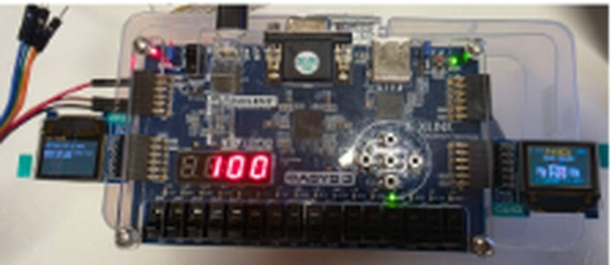
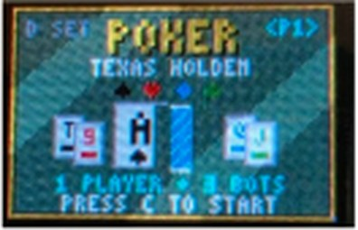
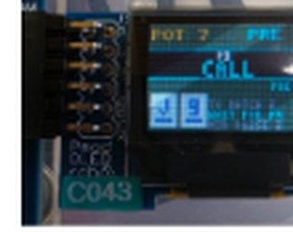
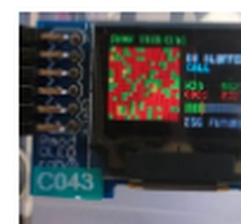
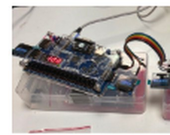

A full game of no-limit Texas Hold'em built in Verilog on a Basys 3 FPGA, with no processor and no software. You play
against three AI opponents on a 96 × 64 Pmod OLED. The whole game runs as logic on the chip: shuffling, dealing,
betting, side pots and showdown. A second board can join over a UART cable for two-player games.

This was a team project. My part was **the AI opponents and the link between two boards**, and that's what this page
covers.

{: .small}

## Inspiration

I'd built chess bots before, but poker is a different problem. Hidden cards and random deals give it far too many
possible outcomes to search exhaustively, and that's especially true on a single Basys 3. RedLogic's video, which
runs huge numbers of random simulations to make Minecraft beat itself, is what gave me the idea of using a Monte Carlo
approach for the bots instead.

  <iframe src="https://www.youtube-nocookie.com/embed/9t2fV52jMA8" title="RedLogic: Running Minecraft Until It Beats Itself"
    loading="lazy" allow="accelerometer; encrypted-media; gyroscope; picture-in-picture" allowfullscreen></iframe>

RedLogic, <a href="https://www.youtube.com/watch?v=9t2fV52jMA8">“Running Minecraft Until It Beats Itself”</a>, YouTube, 2026.

## Bots that estimate their odds

A poker bot can't see the cards still to come, so it can't know whether it will win. My bots estimate it the way a
person might if they could think very fast: they **play out the rest of the hand 256 times with random cards and
count how often they win.** This is a Monte Carlo simulation, built as a hardware state machine.

For each imagined future, the simulator:

1. deals random cards from the ones the bot can't see, to finish the board and give every live opponent two cards
2. scores the bot's hand and every opponent's hand with the shared hand scorer
3. records a win, a tie or a loss

Ties count as a share of the pot (half for a two-way tie, a third for three-way and so on). Shares are counted in
twelfths so every share is a whole number. The bot only ever knows its own two cards and the face-up board cards, so
it can't cheat.

A few things that made this work in hardware:

- **Two simulators in parallel.** A `generate` loop builds two real copies of the simulator, each running 128 futures
  with its own random seed. All 256 futures finish in about **0.08 ms**.
- **Random cards from shifts and XORs.** Each simulator has a 32-bit xorshift generator that produces a new number
  every clock. A 6-bit draw is kept only if it's a real card (below 52) that hasn't been dealt yet. Otherwise it just
  tries again next clock, so every card stays equally likely.
- **Division without a divider.** Turning the points into a percentage needs `points × 100 / 3072`. Division is slow
  and large in hardware, so I split it into cheap steps: multiply by 25 using shifts and adds, drop 8 bits, then
  divide by 3 by multiplying by 683 and dropping 11 bits. I checked every possible total to confirm it's always exact.
  Doing it in one clock missed the 10 ns timing budget, so each step got its own pipeline stage.

## Pre-flop lookup table

Before the flop there's no board yet, so a hand's strength depends only on the two cards and the number of opponents.
That means the answers can be worked out in advance. Only three things matter: the higher rank, the lower rank and
whether the cards share a suit. That shrinks 1,326 starting hands down to **169 kinds**, or 507 numbers for one to three
opponents.

I generated the table with a C program that played 100,000 random hands for every entry, scored the same way as the
hardware. On the FPGA it's a purely combinational `case` statement, so the answer is ready in the same clock.

## Deciding what to do

{: .small}

Once a bot knows its win chance, it compares that with the **pot odds**: the win chance it needs for a call to pay
off. Calling 10 into a pot of 30 needs at least 10 / 40 = 25%. The pot odds are worked out by repeated subtraction,
which takes a few clocks but no divider. Then:

- strong hand → raise (half the pot, or the full pot when it's very strong)
- nothing to call → check
- win chance beats the pot odds → call
- otherwise → fold

Three personalities share this one engine and just shift the thresholds:

- **Tight** plays by the numbers.
- **Loose** calls more often, but only raises with very strong hands.
- **Bluffer** raises with a weak hand about one time in four.

The bots also adapt a little. Every time a bot folds to an all-in it becomes more willing to call the next one, so you
can't just shove every hand to push them around. They also loosen up against more opponents. After deciding, a bot
pauses for a moment so you can follow what happened.

## Show-thinking screen

{: .small}

Flip `sw0` and the OLED shows how the last bot made up its mind. A **16 × 16 grid** has one square for each of the 256
futures it imagined: green if it won, yellow for a tie, red for a loss. The squares fill in one at a time so you can
watch the bot "think". Beside the grid are the bot's personality, its move, its win chance and the pot odds, with a bar
that turns green when calling was worth it.

Like every screen in the project, it isn't drawn into memory first. The display asks "what colour is pixel (x, y)?"
and the module works out the answer on the spot.

## Linking two boards

{: .small}

For two-player games, two boards connect with a pair of wires and a ground. Only one board, the **host**, actually runs
the game. The other is just a remote screen and set of buttons, so the two boards can never disagree about the state
of the game.

- I wrote the **UART transmitter and receiver** myself at 115,200 baud. The receiver passes the incoming wire through
  a two-flip-flop **synchroniser** and samples each bit in the middle, so small clock differences between boards don't
  matter.
- About 90 times a second the host sends a **125-byte frame** with the whole game state, wrapped in a header plus a
  sum and an XOR **checksum**. A corrupted frame is thrown away, and the next one is only about 11 ms behind.
- The other board sends its button presses back every millisecond in a small checked packet.
- If nothing valid arrives for 50 ms, that side counts as unplugged. The host hands that seat to a bot, so the game
  carries on.
- Seats are rotated on each board so every player sees themselves as "YOU", and each board only shows its own
  hole cards.

## What I learnt

- **Thinking in hardware, not code.** A `for` loop in a `generate` block builds copies of a circuit, it doesn't run
  over time. Getting comfortable with that changed how I approached every module.
- **Timing is a design constraint.** The first version of the win-percentage maths failed timing at 100 MHz. Splitting
  it into pipeline stages and replacing division with shifts, adds and constant multiplies fixed it.
- **Precompute what you can.** Moving pre-flop odds into a lookup table generated offline made the first decision of
  every hand instant and freed the simulators for the streets where they matter.
- **Crossing clock domains safely.** Signals from another board don't line up with your clock. Synchronisers,
  checksums and timeouts are what make a link robust instead of flaky.
- **Making AI visible.** The show-thinking screen started as a debugging aid and ended up being the most fun part to
  demo, because you can see exactly why a bot called or folded.

The finished design uses about 14,700 LUTs, roughly 70% of the Basys 3's Artix-7.

## Skills used

- **Verilog:** RTL design of finite state machines, `generate` blocks for parallel hardware, parameterised modules,
  combinational lookup tables and pixel-by-pixel display logic
- **FPGA development:** Vivado synthesis and implementation, meeting timing at 100 MHz with pipelining, resource
  budgeting on an Artix-7, pin constraints (XDC) and on-board debugging on the Basys 3
- **Digital design:** fixed-point arithmetic without dividers, pseudo-random number generation, clock-domain
  synchronisation and serial communication (UART) with error checking
- **Algorithms:** Monte Carlo simulation, pot-odds decision making and offline precomputation in C

**Stack:** Verilog · Vivado · Basys 3 (Artix-7) · Pmod OLED · UART · C (offline table generation)
